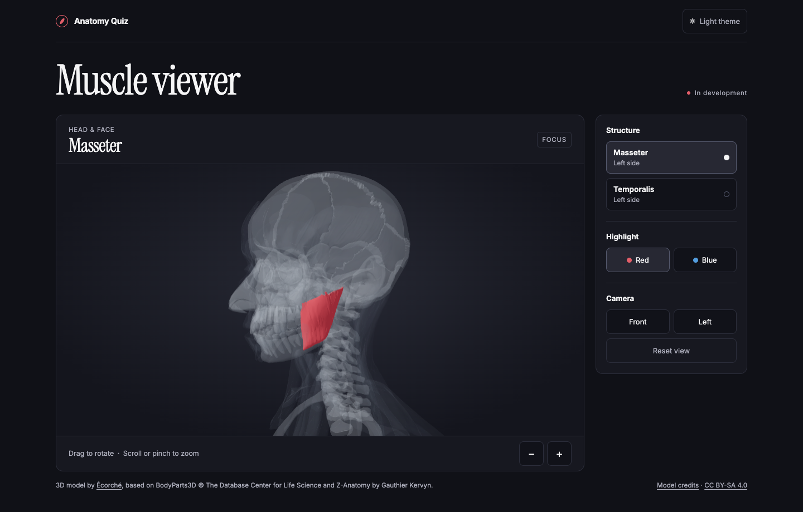
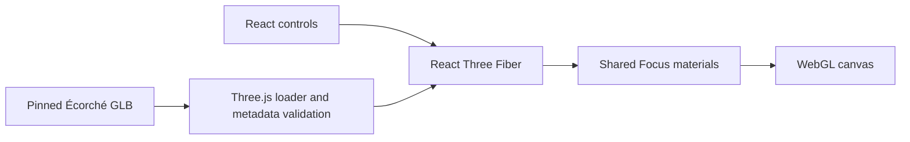

# 3D Anatomy Quiz

A browser-based anatomy project for exploring and eventually practicing a 46-target muscle curriculum in interactive 3D.

**In development · Local prototype**

The current checkpoint includes an interactive viewer and an anatomy review workflow. A hosted demo is planned.



## Try it locally

Use Node 24 and npm. The pinned model and its attribution are included in the checkout.

```sh
npm ci
npm run dev
```

Open the local URL printed by Vite. Pick Masseter or Temporalis, switch Red and Blue, and drag or use the camera controls. Add `?inspect=1` to the development URL to inspect a mesh's source name, side, layer and group.

Open the development URL with `?review=1` to inspect both sides, compare initial views and isolate individual source meshes. The [46-target coverage report](docs/MUSCLE_COVERAGE_V1.md) links to the review images.

## Current features

- Real Écorché geometry for left Masseter and Temporalis preview selections. The two masseter parts are highlighted together.
- Default charcoal Focus view, transparent gray landmarks, and persistent highlight and theme preferences.
- Drag orbit, scroll or pinch zoom, keyboard-accessible zoom buttons, front/left presets and camera reset.
- Download progress, recoverable loading and WebGL failure states, and visible asset credits.
- Anatomy review with left and right views, component isolation, exact mesh metadata, and screenshots for 42 mapped targets.

## Development phases

| Phase | Completed work                                                                                     |
| ----- | -------------------------------------------------------------------------------------------------- |
| 0     | React and TypeScript scaffold, build, test harness, and GitHub Actions configuration               |
| 1     | Interactive Écorché viewer, Focus rendering, camera controls, and mesh inspector                   |
| 2     | Audit of 46 targets, mesh mappings, human review records, screenshots, and an anatomy release gate |

The [development log](docs/DEVELOPMENT_LOG.md) records decisions, setbacks, and actual test results. The [coverage report](docs/MUSCLE_COVERAGE_V1.md) shows 42 mapped, four blocked, and **0 of 46 human-approved**.

## Planned

- Resolve four mapping blockers and obtain human visual approval for all 46 curriculum targets.
- Typing and flashcards, all three display modes, review and results, local progress, and PWA installation.
- Cloudflare Pages deployment and release history.

Human approval is required before a mapped structure can become a graded question. [Anatomy validation notes](docs/ANATOMY_VALIDATION.md)

## Architecture



React and strict TypeScript keep settings and source selectors typed. Vite provides the local server and static build. Three.js decodes GLB geometry, React Three Fiber integrates the scene, and Drei supplies orbit controls. [Architecture details](docs/ARCHITECTURE.md)

## Checks

```sh
npm run lint
npm run typecheck
npm test
npm run anatomy:validate
npm run anatomy:coverage -- --check
npm run build
npx playwright install chromium
npm run test:e2e
```

For installed Google Chrome, run `ANATOMY_USE_CHROME=1 npm run test:e2e`. See the [development log](docs/DEVELOPMENT_LOG.md) for actual results. The read-only GitHub Actions workflow runs lint, typecheck, unit and integration tests, coverage verification, and build. Run `npm run release:check` after the build to evaluate all 46 anatomy release prerequisites.

## Credits and portfolio

The model is Écorché, based on BodyParts3D and Z-Anatomy, and is redistributed under CC BY-SA 4.0. [Asset provenance and licenses](THIRD_PARTY_ASSETS.md)

### Development process and AI assistance

The student supplied the curriculum and defined the project requirements. Codex assisted with implementation and automated checks. [Portfolio summary](docs/PORTFOLIO_SUMMARY.md)

[Roadmap](docs/ROADMAP.md) · [Technical decisions](docs/DECISIONS.md) · [Visual design](docs/VISUAL_DESIGN_SPEC.md) · [Publication instructions](docs/DEPLOYMENT.md)
