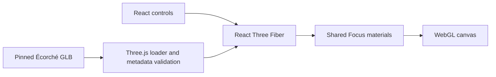

# Anatomy Quiz

Explore human anatomy in interactive 3D, with a 46-target textbook curriculum planned for the first complete release.

**In development · Local prototype**  
**Live Demo** · Pending deployment. Run the local viewer below.  
**Source Code** · This checkout. Public GitHub repository pending authorization.


## Try it locally

Use Node 24 and npm. The pinned model and its attribution are included in the checkout.

```sh
npm ci
npm run dev
```

Open the local URL printed by Vite. Pick Masseter or Temporalis, switch Red and Blue, and drag or use the camera controls. Add `?inspect=1` to the development URL to inspect a mesh's source name, side, layer and group.

## Shipped locally

- Real Écorché geometry for left Masseter and Temporalis preview selections. The two masseter parts are highlighted together.
- Default charcoal Focus view, transparent gray landmarks, and persistent highlight and theme preferences.
- Drag orbit, scroll or pinch zoom, keyboard-accessible zoom buttons, front/left presets and camera reset.
- Download progress, recoverable loading and WebGL failure states, and visible asset credits.

## Planned

- A model audit and human visual approval of all 46 curriculum targets.
- Typing and flashcards, all three display modes, review and results, local progress, and PWA installation.
- GitHub publication, Cloudflare Pages production and preview deployments, and release history.

The scope inventory currently has **0 / 46 approved** targets. The proof of concept focuses on a left-side head view and includes no graded questions. Browser and anatomy review details are tracked in the [development log](docs/DEVELOPMENT_LOG.md) and [anatomy validation notes](docs/ANATOMY_VALIDATION.md).

## Architecture



React and strict TypeScript keep settings and source selectors typed. Vite provides the local server and static build. Three.js decodes GLB geometry, React Three Fiber integrates the scene, and Drei supplies orbit controls. [Architecture details](docs/ARCHITECTURE.md)

## Checks

```sh
npm run lint
npm run typecheck
npm test
npm run build
npx playwright install chromium
npm run test:e2e
```

For installed Google Chrome, run `ANATOMY_USE_CHROME=1 npm run test:e2e`. See the [development log](docs/DEVELOPMENT_LOG.md) for actual results. The read-only GitHub Actions workflow runs lint, typecheck, unit/integration tests and build when the repository is published.

## Credits and portfolio

The model is Écorché, based on BodyParts3D and Z-Anatomy, and is redistributed under CC BY-SA 4.0. [Asset provenance and licenses](THIRD_PARTY_ASSETS.md)

### Development process and AI assistance

The student supplied the curriculum and product constraints. Codex built this checkpoint and its checks. The [development log](docs/DEVELOPMENT_LOG.md) records the implementation and verification, and the [portfolio summary](docs/PORTFOLIO_SUMMARY.md) is in progress.

[Roadmap](docs/ROADMAP.md) · [Technical decisions](docs/DECISIONS.md) · [Visual design](docs/VISUAL_DESIGN_SPEC.md) · [Publication instructions](docs/DEPLOYMENT.md)

Issues and releases will be linked once the public repository exists.
