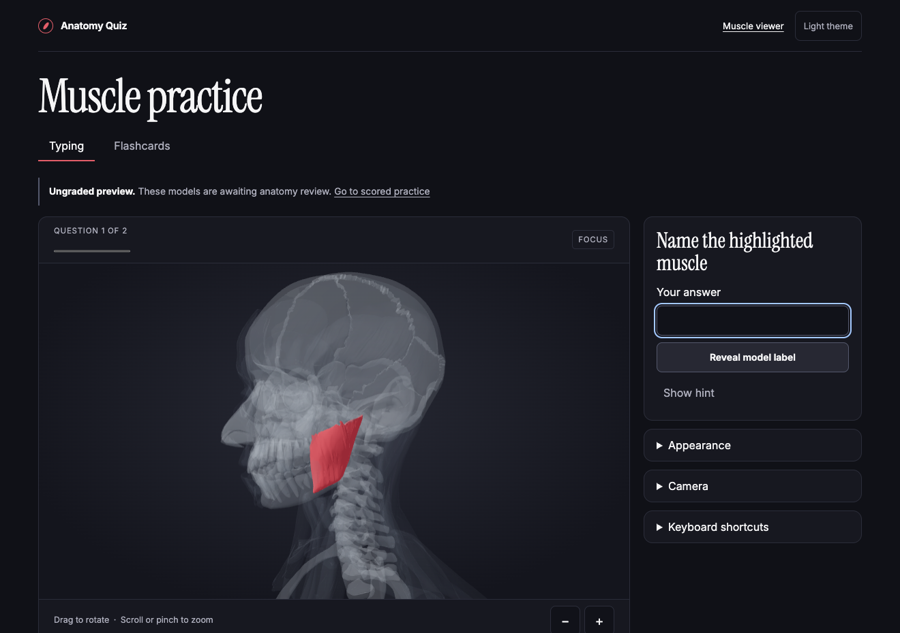
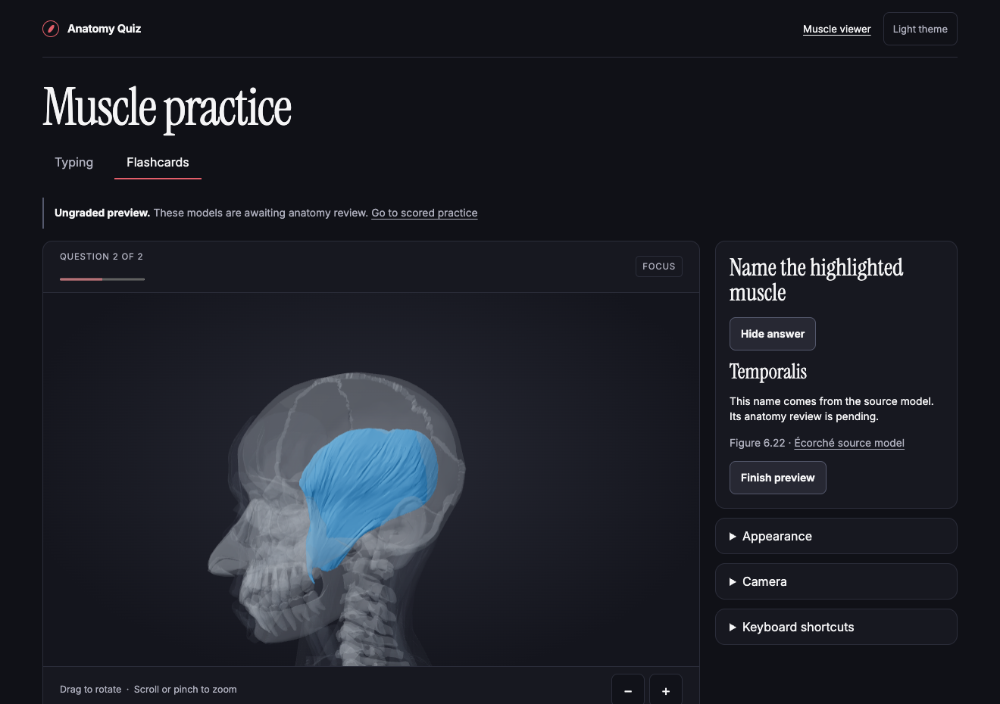

# 3D Anatomy Quiz

A browser-based study app that uses interactive 3D models to help students identify muscles. Its curriculum tracks 46 targets from two assigned anatomy figures.

**Phase 3 development preview.** Try typing or flashcards with Masseter and Temporalis. Scored practice opens for each target after human anatomy review.



## Try it locally

Use Node 24 and npm. The pinned model and its attribution are included.

```sh
npm ci
npm run dev
```

Open the URL printed by Vite. Choose **Ungraded preview** in the header, then **Typing** or **Flashcards**. Type a guess or reveal the source model label. The preview saves no scores or recall ratings.

**Scored practice** currently shows an empty state because the anatomy ledger has **0 of 46 human-approved targets**. Once a target is approved, typing checks the answer and flashcards ask for an explicit recall rating.

## What works today

- Typing and flashcards share an orbitable viewer with camera presets, zoom, and reset.
- Focus, Strict Quiz, and Context modes keep the target opaque in red or blue and use gray for supporting anatomy. Appearance and theme preferences persist in the browser.
- The development-only anatomy reviewer shows each mapped target on both sides. Open the local URL with `?review=1`, select a target, and toggle **Show more surrounding anatomy** when you need additional landmarks. The picker labels four blocked targets.
- The [coverage report](docs/MUSCLE_COVERAGE_V1.md) links to evidence for all 42 mapped targets and explains each blocked mapping.



## Development phases

| Phase | Scope                                                                  |
| ----- | ---------------------------------------------------------------------- |
| 0     | React and TypeScript scaffold, build, tests, and GitHub Actions        |
| 1     | Interactive Écorché viewer, camera controls, and mesh inspector        |
| 2     | 46-target audit, human review ledger, evidence, and release gate       |
| 3     | Typing, flashcards, preview navigation, and shared appearance controls |

Planned milestones include saved progress, missed-question review, and installable practice. The complete release requires licensed, visible geometry and human approval for all 46 targets. [Roadmap](docs/ROADMAP.md) · [Development log](docs/DEVELOPMENT_LOG.md)

## Checks

```sh
npm run lint
npm run typecheck
npm test
npm run anatomy:validate
npm run anatomy:coverage -- --check
npm run build
npx playwright install chromium
npm run test:e2e
```

Use `ANATOMY_USE_CHROME=1 npm run test:e2e` for installed Google Chrome. To check the v1.0 anatomy gate, run `npm run release:check` after building. The current ledger leaves that gate closed.

## Credits and portfolio

The model is Écorché by Charleeh, based on BodyParts3D and Z-Anatomy and redistributed under CC BY-SA 4.0. The screenshots show this app's rendering of that model. [Asset attribution and licenses](THIRD_PARTY_ASSETS.md)

The student supplied the curriculum and defined the design, learning, and release requirements. Codex assisted with implementation and automated checks. [Portfolio summary](docs/PORTFOLIO_SUMMARY.md) · [Architecture](docs/ARCHITECTURE.md) · [Keyboard shortcuts](docs/KEYBOARD_SHORTCUTS.md)
