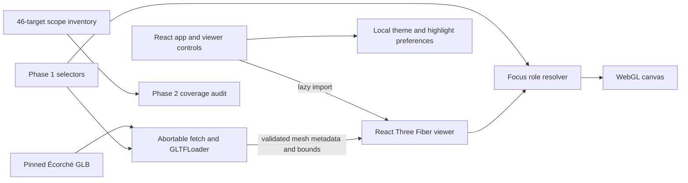

# Architecture

The loader validates exact metadata and computes world-space bounds after applying source transforms. The viewer reassigns one of three shared, vertex-color-free materials per mesh and restores the source material references on cleanup. Target changes re-evaluate all roles. Canvas rendering is demand-driven and capped at 1.5 device pixel ratio. The loader aborts a request on unmount and discards decoded results if cancellation happened during decoding.

The viewport resets and frames from the active bounding box. Controls use the same world coordinate space as the source model. The optional development inspector surfaces selected metadata without requiring that a mesh be individually visible through other target surfaces.
